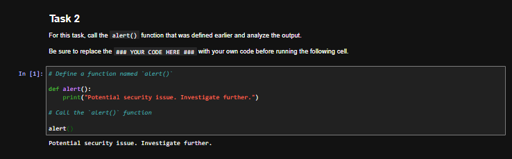
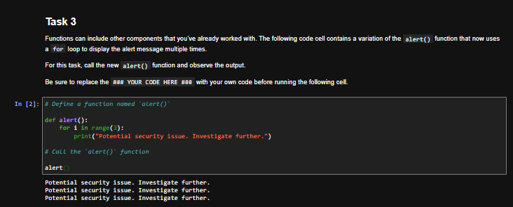
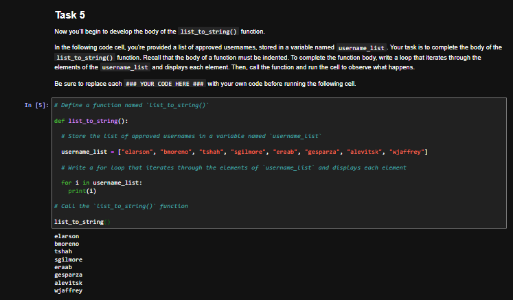
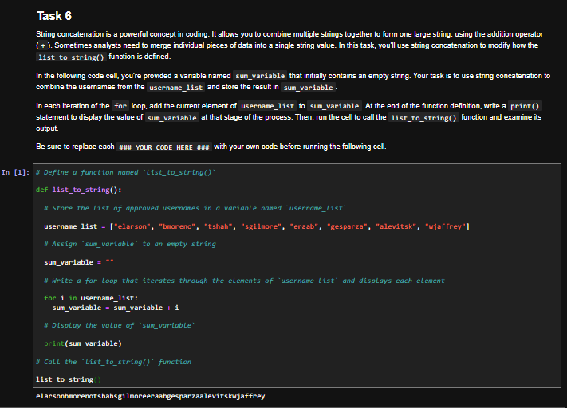
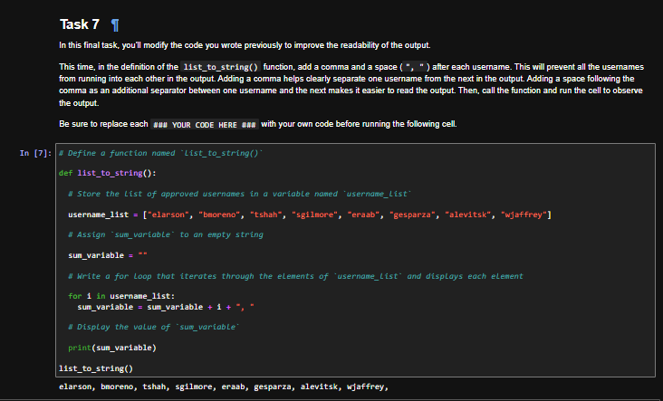

# Python Functions: Security Alerts and Approved Username Lists

## Summary

In this lab from the Google Cybersecurity Certificate (Automate Cybersecurity Tasks with Python), I defined and called my own Python functions to automate small security tasks: displaying a security alert, repeating that alert with a loop, and turning a list of approved usernames into a single readable string using string concatenation. The scenario and usernames are fictional and provided by the course.

## Tools Used

- Python 3
- Jupyter Notebook (course lab environment)

## Skills Demonstrated

- Defining functions with `def`
- Calling functions
- Using a `for` loop inside a function body
- Iterating through a list of approved usernames
- String concatenation with the `+` operator
- Formatting output with a separator for readability

## Part 1: A Security Alert Function

**Call the `alert()` function.** The function prints a security alert message each time it is called.

```python
def alert():
    print("Potential security issue. Investigate further.")

alert()
```



**Loop inside the function.** A variation of `alert()` uses a `for` loop with `range(3)` so one call displays the alert three times.

```python
def alert():
    for i in range(3):
        print("Potential security issue. Investigate further.")

alert()
```



## Part 2: Building a List of Approved Usernames

**Loop through the list.** The `list_to_string()` function stores the approved usernames in a list and prints each one.

```python
def list_to_string():
    username_list = ["elarson", "bmoreno", "tshah", "sgilmore", "eraab", "gesparza", "alevitsk", "wjaffrey"]

    for i in username_list:
        print(i)

list_to_string()
```



**String concatenation.** Instead of printing each name separately, the loop adds each username onto `sum_variable`, which starts as an empty string, and the function prints the combined result once at the end. The names run together because `+` joins strings exactly as they are.

```python
def list_to_string():
    username_list = ["elarson", "bmoreno", "tshah", "sgilmore", "eraab", "gesparza", "alevitsk", "wjaffrey"]
    sum_variable = ""

    for i in username_list:
        sum_variable = sum_variable + i

    print(sum_variable)

list_to_string()
```



**Readable output.** Adding a comma and a space after each username separates the names, while the list itself keeps the original clean usernames.

```python
def list_to_string():
    username_list = ["elarson", "bmoreno", "tshah", "sgilmore", "eraab", "gesparza", "alevitsk", "wjaffrey"]
    sum_variable = ""

    for i in username_list:
        sum_variable = sum_variable + i + ", "

    print(sum_variable)

list_to_string()
```



## Key Takeaways

- A function packages code under a name so it can be reused by calling it, instead of rewriting the same steps each time.
- The body of a function must be indented under the `def` line, and the call goes back at the left margin, outside the function.
- Functions can contain other building blocks, such as loops, lists, and variables.
- String concatenation with `+` builds one string from many pieces, and adding a separator like `", "` in the loop keeps the output readable without changing the underlying data.
- Placing `print()` after the loop, rather than inside it, displays the finished result once.
